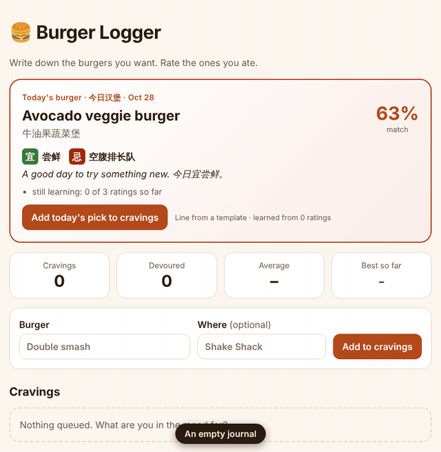
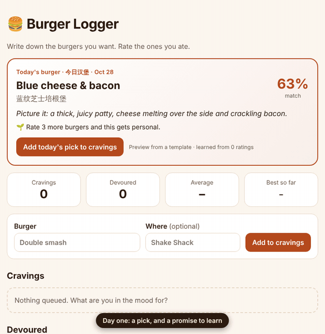
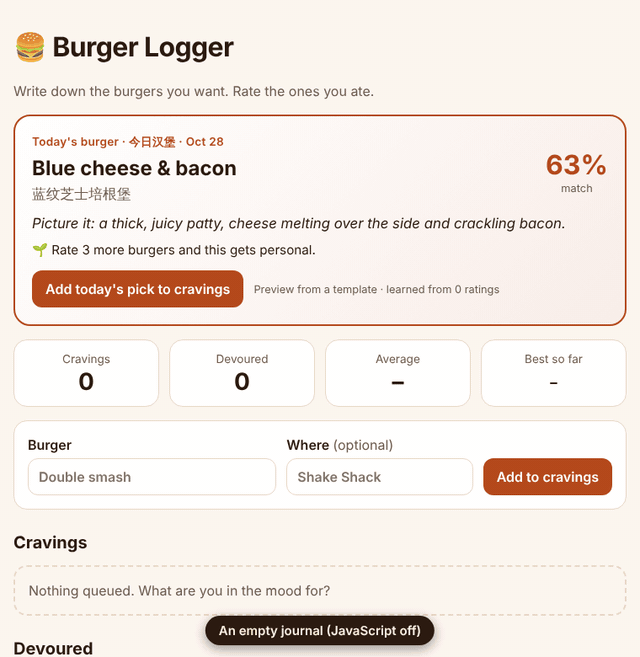
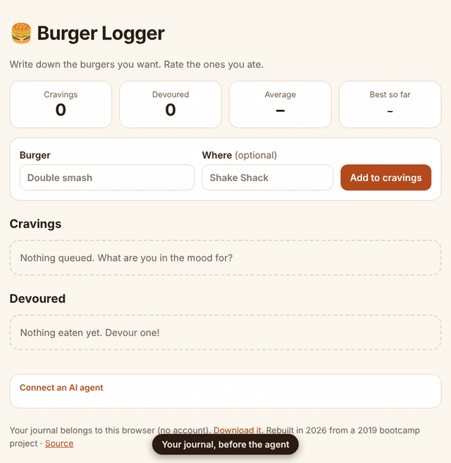
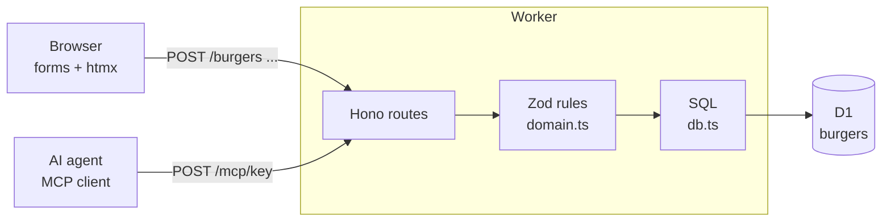

# 🍔 Burger Logger

A craving list and tasting journal. Write down the burgers you want, then **devour** them with a 1–5 rating and a note. Every day, **今日汉堡** (today's burger) picks one for you from what it has learned about your taste.



> Originally a 2019 bootcamp assignment (Express, MySQL, Handlebars and a hand-made ORM), rebuilt in 2026.

## What this project is for

The original taught the basic CRUD loop: *form → route → SQL → HTML*. This version keeps that loop and uses it to teach three things the other projects in this set don't:

1. **HTML over the wire.** No React, no Vue, no build step. The server renders pages and [htmx](https://htmx.org) swaps them in place.
2. **One domain, two doors.** People use the web forms; AI agents use [MCP](https://modelcontextprotocol.io). Both go through the same validation and SQL, so they can't disagree.
3. **Privacy without accounts.** Every browser gets its own private journal from a random key. No sign-up, no passwords.
4. **Small ML you can read, with an LLM where it helps.** A tiny taste model learns from your ratings; a language model is optional and only processes text.

## 今日汉堡: today's burger



How the card is made, in three steps you can read in [`src/taste/`](src/taste):

1. **Text → features.** Each burger's name and note become tags from a fixed list, with sentiment: *"great bacon, a bit salty"* → `bacon +1, salty −1`. A keyword tagger (English and Chinese) runs instantly; if a model is connected it re-reads the text in the background and its validated tags replace the keyword ones.
2. **Features → taste.** Each rating minus your average is shared among that burger's tags; praise or complaints push a tag one more point. Dividing by `count + 2` keeps a tag near zero until it has a few examples (the idea behind ridge regularisation). Weights like `smoky +0.8, salty −0.9` are the whole model.
3. **Taste → today's pick.** Your cravings and 20 classic styles are scored, with a bonus for a patty you haven't had in two weeks. One is drawn with a die seeded by your journal and the date, so it is the **same pick all day**, like a daily almanac: **宜** what today favours, **忌** what to avoid.

A model, if configured, only writes the witty line. Until it answers, or if it fails, a template line stands in. The card says which wrote it.

## See it work

| No JavaScript at all | An AI agent logs a burger |
| --- | --- |
|  |  |
| Plain `<form>`s and redirects, so it works everywhere. htmx only makes it smoother. | Real MCP calls against a local server, then the same journal in the browser. |

## Run it

```sh
corepack enable
pnpm install
pnpm dev          # http://localhost:8787, with a local D1 database
```

| Command | What it does |
| --- | --- |
| `pnpm test` | Worker tests inside the real Workers runtime (workerd) with a local D1, once without a model and once with a scripted fake model |
| `pnpm e2e` | Playwright: desktop and phone, JavaScript on and off, axe accessibility scans in both themes |
| `pnpm validate` | Lint, types, tests, build, e2e, knip |
| `pnpm gifs` | Re-records the GIFs above from the live app (needs `ffmpeg`) |

## How it works



Read the code in this order; it is about 600 lines in total:

| File | What to learn from it |
| --- | --- |
| [`migrations/0001_burgers.sql`](migrations/0001_burgers.sql) | The **state machine lives in the schema**: a `CHECK` makes it impossible to store a devoured burger without a rating, or a craving with one. |
| [`src/domain.ts`](src/domain.ts) | One Zod definition of the rules, plus the key helpers. Both doors import it. |
| [`src/db.ts`](src/db.ts) | Plain SQL with `RETURNING`. The 200-burger limit is **inside** the `INSERT`, so two simultaneous requests can't both pass it. |
| [`src/index.tsx`](src/index.tsx) | Routes, the journal cookie, CSRF, and the CSP. Each form action is a `POST` that redirects (`303`) back to `/`. |
| [`src/views.tsx`](src/views.tsx) | Server-rendered JSX components. The "Devour it!" form is a native `<details>` element: no JavaScript needed to open it. |
| [`src/mcp.ts`](src/mcp.ts) | Seven MCP tools, run **stateless** (a fresh server per request), which suits Workers. |
| [`src/taste/`](src/taste) | Tagging (`tags.ts`), the taste model and daily pick (`model.ts`), the built-in catalog. Pure functions, unit-tested. |
| [`src/ai/`](src/ai) | The model layer: one `ChatModel` interface, four providers, and `generateObject` (JSON validated by Zod, one repair attempt). |
| [`src/today.ts`](src/today.ts) | Glue: tagging after each change, the cached daily card, background work with `waitUntil`. |
| [`test/app.test.ts`](test/app.test.ts) | The tests, including "one visitor can't touch another's burger" and "a cross-site POST is rejected". |

### Design decisions

- **Your journal is a secret key, not an account.** A random 192-bit key lives in an `HttpOnly` cookie. The database stores only its SHA-256, so a leaked database contains no usable keys.
- **The MCP link is that same key** (`/mcp/<key>`), shown under *Connect an AI agent*. Anyone with the link can read and write that journal, so treat it like a password. Clear your cookies and you get a new, empty journal.
- **htmx progressively enhances.** `hx-boost` on `<body>` turns every link and form into an in-place swap; with JavaScript off the browser does a normal navigation. Same server code either way.
- **MCP SDK trade-off.** The official SDK brings the protocol details for free but is most of the bundle (about 270 KiB gzipped, far under the Workers limit). A hand-written JSON-RPC handler would be ~100 lines and tiny; the SDK is the better default while the spec is still moving.
- **Strict CSP.** `script-src 'self'` and `style-src 'self'`, so htmx is vendored into `public/` (`pnpm vendor`) and configured with a `<meta>` tag instead of inline scripts.

## Bring your own model

Everything works without a model. To add one, set four values (in `.dev.vars` locally, as Worker secrets in production; see [`.dev.vars.example`](.dev.vars.example)):

| `AI_PROVIDER` | Covers | `AI_BASE_URL` |
| --- | --- | --- |
| `ollama` | Local Ollama (Qwen, DeepSeek, GLM, Llama…) or Ollama Cloud | `http://localhost:11434` or `https://ollama.com` |
| `openai` | Any OpenAI-compatible API: DeepSeek, Qwen (DashScope), GLM, Kimi K2, OpenAI, Gemini | the vendor's base URL |
| `anthropic` | Claude | (default) |
| `none` | No model: keyword tagging and template lines | |

Plus `AI_MODEL` and, for hosted models, `AI_API_KEY`. Keys stay on the server; switching from a free model to a paid one is a config change, not a code change. In production: `pnpm exec wrangler secret put AI_PROVIDER` (and the same for the other three).

Every model reply passes through [`generateObject`](src/ai/structured.ts): the Zod schema is sent as JSON Schema (Ollama enforces it natively), the reply is validated, and an invalid one gets one repair attempt before it is rejected. Tags must come from the fixed list, so a model can't invent features that would confuse the taste model.

## Connect an AI agent (MCP)

Open the page, expand **Connect an AI agent**, and copy your private URL. Then, for example:

```sh
claude mcp add --transport http burger-logger "https://<your-site>/mcp/<your-key>"
```

Ask: *"I want to try a double smash at Shake Shack, add it."* Later: *"I ate it, 4 out of 5, great bun."* Or try the protocol directly:

```sh
curl -s "$URL" -H 'content-type: application/json' -H 'accept: application/json, text/event-stream' \
  -d '{"jsonrpc":"2.0","id":1,"method":"tools/call","params":{"name":"add_burger","arguments":{"name":"Double smash"}}}'
```

Tools: `add_burger`, `devour_burger`, `list_burgers`, `delete_burger`, `journal_stats`, `todays_burger`, `taste_profile`. Ask your agent *"what's my burger today, and why?"*

## Deploy

Everything is declared in [`wrangler.jsonc`](wrangler.jsonc): one Worker, static files from `public/`, one D1 database.

```sh
pnpm exec wrangler login
pnpm exec wrangler d1 create burger-logger   # put the printed database_id in wrangler.jsonc
pnpm run cf:deploy                           # type-check and deploy
pnpm run db:migrate:remote                   # create the table (again after each new migration)
```

With **Workers Builds** (Git integration) use build command `pnpm install --frozen-lockfile`, deploy command `pnpm exec wrangler deploy`, and leave the branch command as the default `npx wrangler preview` (this repo already has the `previews` block it needs). The token Workers Builds creates cannot edit D1, which is why the `database_id` is committed. Prefer **one** deploy path: Workers Builds *or* the GitHub Actions job (`CLOUDFLARE_API_TOKEN` and `CLOUDFLARE_ACCOUNT_ID` secrets).

## Honest limits

- **No rate limiting.** Anyone can create a journal and fill it to 200 burgers. Add a [Rate Limiting binding](https://developers.cloudflare.com/workers/runtime-apis/bindings/rate-limit/) or Turnstile before real traffic.
- **Lost cookie = lost journal** (unless you saved the MCP link or downloaded the JSON). That is the price of having no accounts.
- **There is no key rotation yet.** If the link leaks, clear the cookie and start a new journal.
- **A deployed Worker can't reach `localhost`.** Use a hosted endpoint (Ollama Cloud or a paid API) in production, or expose your own Ollama through a Cloudflare Tunnel.
- **The taste model is small on purpose.** With a handful of ratings it is a hint, not a prediction; the card says how many ratings it learned from.

## Ideas to extend

These are not built; each needs only a small step from here.

- **Make it at home:** turn today's pick plus your notes ("great bun, a bit salty") into a recipe that keeps what you liked and fixes what you didn't, then a shared shopping list for a cookout.
- **Taste-off:** run the same request through two models side by side and pick the better answer; the picks become a small eval set for comparing models.
- **Natural-language logging:** "had the Bacon stack at Five Guys, 4/5" → `add_burger` + `devour_burger`, through the same validated tools.
- **n8n:** a morning workflow that calls `todays_burger` over MCP and posts the card to Slack or WeChat.

## Credits

© 2019–2026 Paul Xu. Built at the University of Toronto School of Continuing Studies Coding Boot Camp (2019) and rebuilt in 2026.
